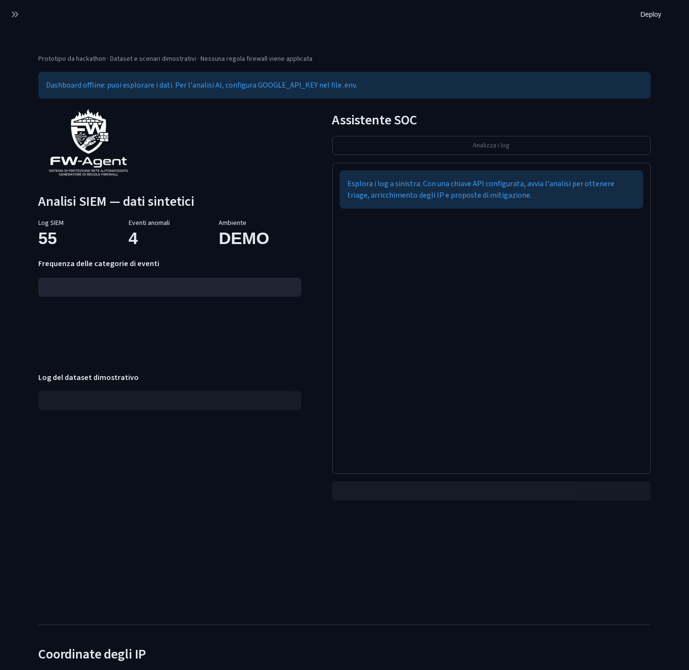

# FW-Agent — SOC Investigation Assistant

A **team hackathon prototype** that combines Python, LangGraph and a Streamlit dashboard to investigate synthetic security events, enrich IP indicators and prepare defensive actions for human review.

Built for **Unchained: The Agentic Era**, **21 March 2026**, by **Federico Capitani, Lorenzo Giandomenico and Giuseppe Mininni**. The implementation was developed collaboratively.



*The screenshot shows the real dashboard in offline mode. The interface and original prompts are in Italian; this README is in English.*

## What it does

- Displays a local dataset of **55 synthetic SIEM events**, with event counts and categories.
- Orchestrates three agent roles: **triage**, **network intelligence** and **mitigation assistance**.
- Searches local JSON logs and a fictional threat-intelligence fixture.
- Returns explicitly labelled synthetic coordinates for documentation IPs; optionally queries IPAPI for other public IPv4 addresses.
- Generates **reviewable firewall command drafts** for iptables, UFW and Cisco ACL syntax.
- Pauses the workflow for operator input. Code checks the selected **action and IPv4 address** before invoking a mitigation tool, and clears those permissions afterwards.
- Simulates a local web-container demo by default; real Docker execution requires a separate configuration opt-in and UI confirmation.

**Scope:** the application analyses demonstration data. It does not ingest live SIEM telemetry, apply firewall rules, isolate networks or automatically block attackers. The container demo runs `nginxdemos/hello`; it is not a complete honeypot and does not redirect traffic.

## Quick start

**Requirements:** Python **3.12 or later**. Locally verified with Python **3.14**. Docker and a Google API key are optional.

```bash
git clone https://github.com/Kappa-02/FW-Agent.git
cd FW-Agent
python3 -m venv .venv
source .venv/bin/activate
python -m pip install -r requirements.lock.txt
python -m streamlit run app_soc.py
```

On Windows, create the environment with `py -m venv .venv` and activate it with `.venv\Scripts\Activate.ps1` in PowerShell.

Open the local URL printed by Streamlit. **Without an API key**, the dashboard still displays the logs, counts and event chart; AI analysis is disabled and no model requests are made.

`requirements.lock.txt` records the complete environment used for verification, excluding browser tooling used only to capture the screenshot. `requirements.txt` lists the application's direct dependencies with tested versions.

### Enable AI analysis

1. Copy `.env.example` to `.env` in the repository root.
2. Set `GOOGLE_API_KEY` to your own Google API key.
3. Restart Streamlit and click **Analizza i log**.

The default model is `gemini-2.5-flash`. Use `FW_AGENT_MODEL` to select a model available to your account. `GEMINI_API_KEY` is accepted as an alternative key name. The `.env` file is ignored by Git.

This mode sends the scenario and conversation to the configured Google model and may consume API quota. Geolocation of other public addresses uses IPAPI. Keep real confidential logs out of this demo.

### Review proposed actions

After investigation, select the IP addresses, tick the confirmation checkbox and choose an action:

| Action | Actual effect |
| --- | --- |
| **Prepara regole** | Returns command text marked `RULE DRAFT — NOT APPLIED`. No firewall command is executed. |
| **Demo container**, default configuration | Returns `SIMULATION`; no Docker command is run. |
| **Demo container**, `FW_AGENT_ENABLE_DOCKER=true` | Attempts to start a sample web container on `127.0.0.1:8080`. Reports failure as `ERROR`, or confirms that this specific demo container started. |

Chat messages alone do not grant mitigation permissions. The graph checks each tool request against the UI's selected actions and IPs, permits each action/IP pair once per confirmation, and clears the grant after that turn. Each agent loop is limited to eight model responses.

The Docker demo uses a fixed local port, so an occupied port or existing container name can prevent startup. Existing containers are never removed automatically. Inspect or remove a demo manually when finished:

```bash
docker ps --filter name=fw-agent-demo-
docker rm -f fw-agent-demo-demo
```

## Architecture

```text
Synthetic JSON events
        │
        ▼
Triage agent ──► Network intelligence agent
                         │
                         ▼
                 Operator review in UI
                         │
              Selected actions + IPs
                         ▼
               Code approval check
                         │
                         ▼
                 Mitigation assistant
                 ├── Firewall draft
                 └── Simulated / local container demo
                         │
                         └──► Operator review
```

**Stack:** Python · LangGraph · LangChain Google GenAI · Streamlit · pandas · requests.

```text
FW-Agent/
├── app_soc.py                 # Streamlit dashboard and operator controls
├── agents/soc_graph.py        # Agent roles, graph and approval enforcement
├── tools/
│   ├── security_tools.py      # Log lookup, IP enrichment and action tools
│   └── check_models.py        # Optional Google model availability helper
├── data/                      # Synthetic default scenario and reference fixtures
├── assets/Logo.png
├── docs/images/dashboard.png
├── tests/                     # Offline regression and dashboard tests
├── Presentazione.pdf          # Original hackathon slides
├── .env.example
├── requirements.txt
└── requirements.lock.txt
```

See [data/README.md](data/README.md) for the default scenario and the two additional 40-event fixtures preserved from the original project folder. The current application loads `data/siem_logs.json`.

## Verification

With the virtual environment active, run:

```bash
python -m unittest discover -s tests -t . -v
python -m pip check
```

The tests cover input validation, read-only firewall drafting, Docker opt-in and failure reporting, action/IP approval, checkpoint resume, permission expiry, and dashboard operation without an API key. They exercise the real graph with a deterministic local model substitute; HTTP and Docker effects are mocked. **No live Gemini analysis or Docker deployment is claimed by these tests.**

## Project notes

- The [original presentation](Presentazione.pdf) is retained as an artefact of the hackathon. This README describes the current implementation and its limitations.
- Session memory is held in process. This prototype does not provide production authentication, role management, durable auditing or a sandbox for generated recommendations.
- Generated commands and model conclusions require review; an AI response is not evidence that a defensive action succeeded. Tool outputs are shown separately in the dashboard.
- No explicit software licence has been added; the repository remains a collaborative hackathon project.
